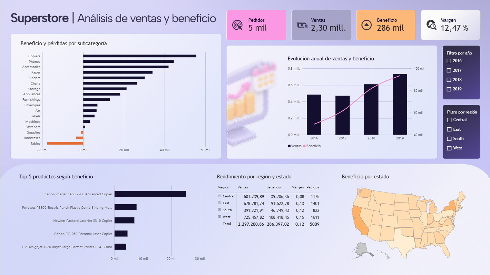
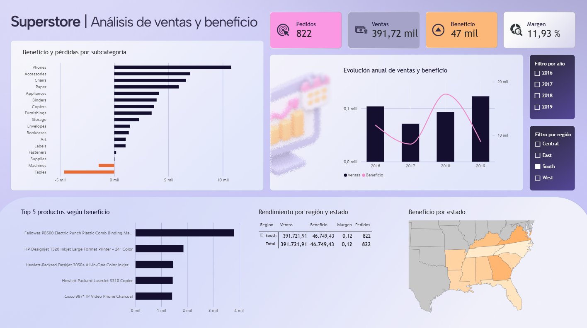

Quería entender si los productos y las regiones que más venden son también los que más beneficio dejan. Para responder a esa pregunta, diseñé un dashboard en Power BI que permite pasar de la visión general al detalle por año, región y producto.

## Cómo construí el dashboard

Trabajé con la hoja de pedidos de *Sample – Superstore*. Cada fila corresponde a una línea de pedido, así que en DAX conté los identificadores únicos para calcular el número de pedidos. El margen lo calculé dividiendo el beneficio total entre las ventas totales.

Organicé el dashboard para poder leerlo de arriba abajo. Primero aparecen los cuatro indicadores principales. Después, el gráfico anual permite comparar ventas y beneficio, y las barras naranjas ayudan a localizar las subcategorías con pérdidas. En la parte inferior, el ranking de productos, la tabla regional y el mapa permiten ver dónde se concentra el beneficio.

## Qué encontré

- **Las ventas y el beneficio evolucionaron de forma distinta.** Entre 2016 y 2019, Superstore registró 5.009 pedidos, 2,30 millones en ventas y 286.397 en beneficio, con un margen del 12,47 %. En 2017 las ventas bajaron ligeramente frente a 2016, pero el beneficio siguió subiendo. En 2019, ambas métricas alcanzaron su máximo en la vista general.
- **El oeste lideró en ventas y beneficio.** La región West generó unas 725.458 en ventas y 108.418 en beneficio, con un margen del 14,94 %. Central vendió más que South, pero obtuvo menos beneficio y tuvo el margen más bajo de las cuatro regiones, un 7,92 %.
- **Las fotocopiadoras lideraron y las mesas concentraron las mayores pérdidas.** *Copiers* fue la subcategoría con mayor beneficio y la Canon imageCLASS 2200 encabezó el ranking de productos. *Tables* fue la subcategoría con más pérdidas, seguida de *Bookcases* y *Supplies*.

## Qué cambia al filtrar por el sur

Al seleccionar **South**, el dashboard muestra 822 pedidos, 391.721,91 en ventas y 46.749,43 en beneficio, con un margen del 11,93 %. En esta región, *Phones* pasa a liderar el beneficio por subcategoría y *Tables* sigue siendo la que más pierde. También cambia la lectura del gráfico anual: 2019 fue el año con más ventas en el sur, pero su beneficio quedó por debajo del de 2018.

Este contraste me ayuda a decidir por dónde seguir el análisis. Revisaría primero qué pasó en el sur entre 2018 y 2019 y desglosaría las pérdidas de *Tables* por estado, producto y nivel de descuento.

## Fuente de datos

Análisis y visualización propios en Power BI a partir de *Sample – Superstore*, conjunto de datos de ejemplo de Tableau (Salesforce) sobre una empresa ficticia. [Descarga oficial del Excel](https://www.tableau.com/sites/default/files/pages/sample_-_superstore.xls).
